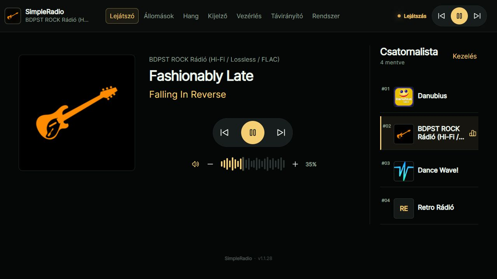
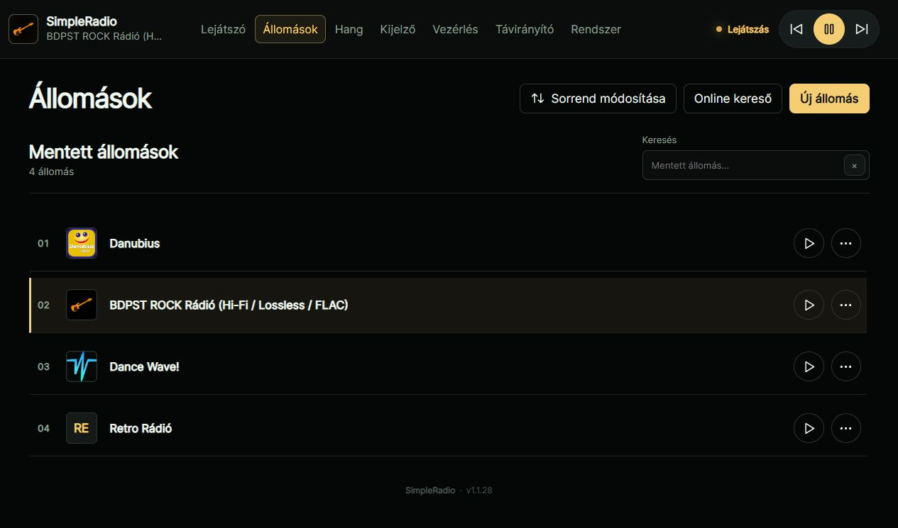
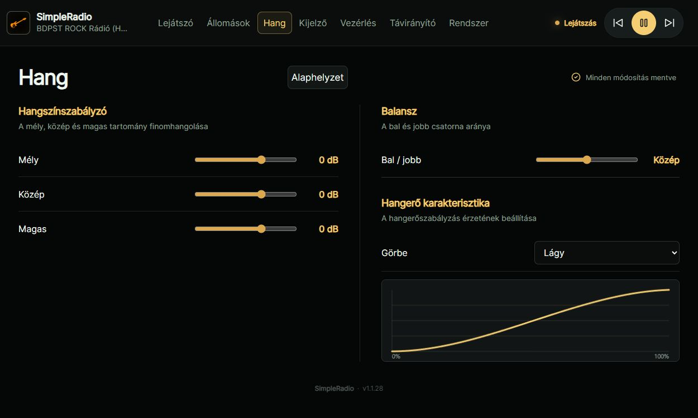
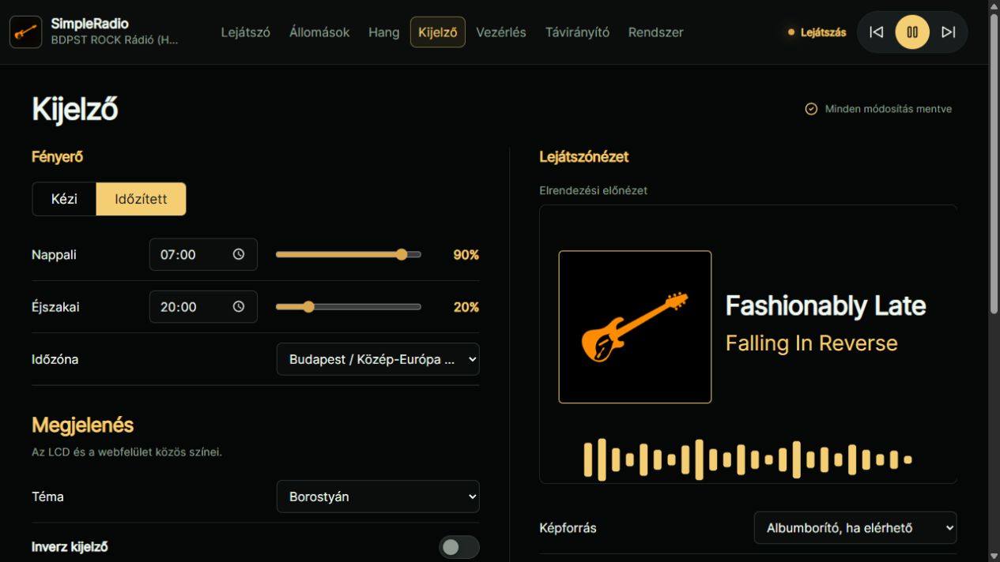
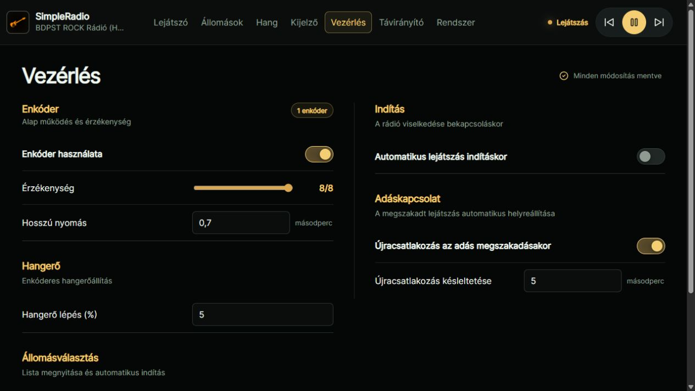
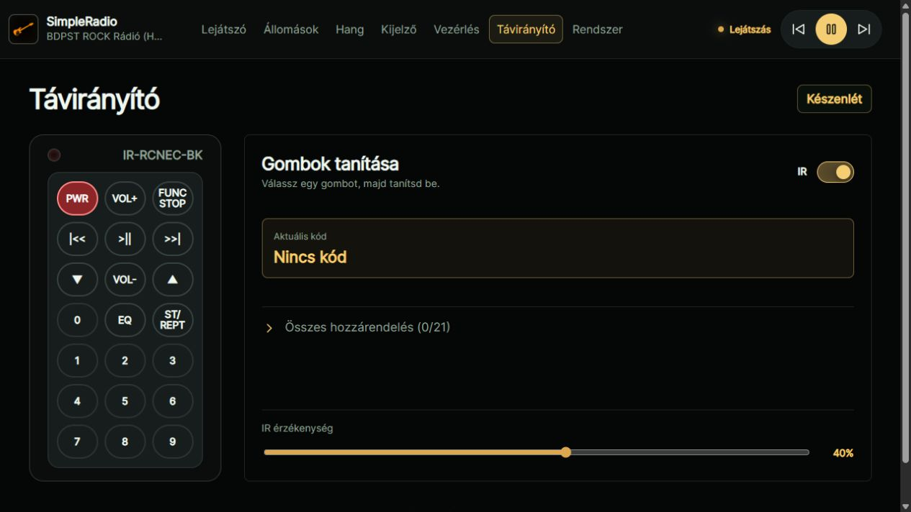
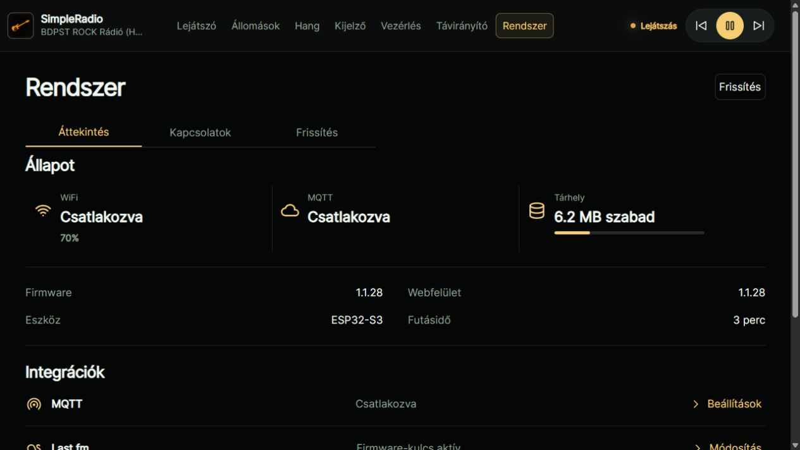
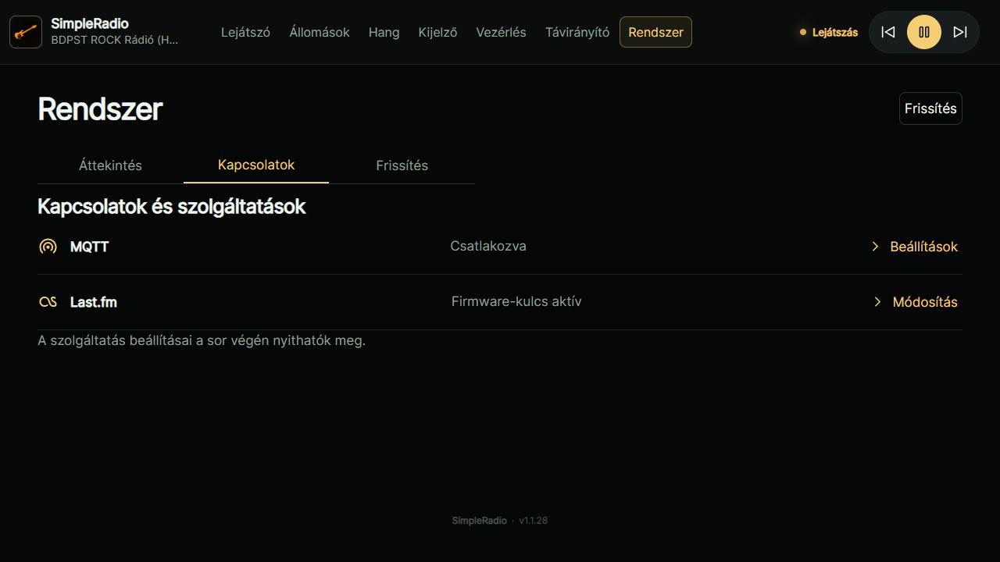
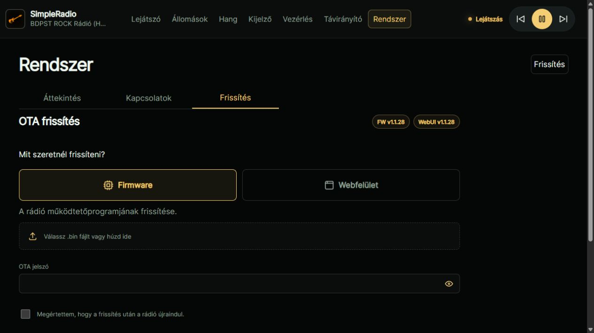

# SimpleRadio

[English](README.md)

> Jelenlegi verzió: **1.1.28** · ESP32-S3 N16R8 · magyar és angol felület

## Főbb funkciók

- Internet-rádió I2S hangkimenettel; MP3, AAC/AAC+, FLAC, OGG/Vorbis és Opus támogatás.
- LCD-lejátszó állomáslogóval vagy albumborítóval, előadóval és számcímmel.
- Gyors, kis logós állomásválasztó; VU, 24 sávos FFT-spektrum és készenléti órák.
- Mobilon is használható webfelület: lejátszás, állomáskeresés, EQ, balansz és kijelzőbeállítások.
- Közös LCD/webes témák; élő csúszka-előnézet, mentés az állítás végén.
- Egy vagy két enkóder, opcionális IR-távirányító és RGB LED.
- MQTT discovery és [Home Assistant-kártya](home-assistant/README.md).

## Hardver és beállítás

- Tesztelt hardver: **ESP32-S3 N16R8**, **ILI9488 480×320 SPI LCD**, I2S DAC/erősítő, például MAX98357A.
- További kijelzőprofilok: ST7796 480×320 és ILI9341 320×240.
- Pinek, hardver és fordításkori nyelv: [`hardware_config.h`](src/config/hardware_config.h).
- Saját nyelv: [útmutató és sablonok](data/i18n/README.md).
- Előre megadott WiFi-, Last.fm-, MQTT- és OTA-adatok: helyi `secrets.ini`, a [mintafájl](secrets.example.ini) alapján. Valódi kulcsokat és jelszavakat ne publikálj.
- A Last.fm API-kulcs a webes **Rendszer** oldalon is megadható; a weben mentett kulcs elsőbbséget kap.

## Feltöltés és frissítés

- Fejlesztőkörnyezet: VS Code + PlatformIO/PioArduino; a függőségeket a projekt kezeli.
- Első telepítés: firmware — `pio run -t upload`; webfelület/data — `pio run -t uploadfs`. **Mindkettő szükséges.**
- Mentett WiFi nélkül az **ESP32-WebRadio** hozzáférési ponton állítható be a hálózat.
- Későbbi OTA-feltöltés: a webes **Rendszer → Frissítés** oldalon.
- Firmware-módosításhoz firmware-, `data/` módosításhoz data-feltöltés kell; ha mindkettő változik, mindkettőt töltsd fel.
- A data OTA megőrzi a beállításokat és az állomáslistát; a logócache újraépül.
- Soros napló: `pio device monitor -b 115200`.
- Központi firmware-/WebUI-verziók: [`version.h`](src/config/version.h); a webes verzióadatok fordításkor automatikusan frissülnek.

## Hivatkozások

- [Webfelület és LCD működése](docs/ui-refresh.md)
- [GNU GPL v3 licenc](LICENSE) · [Külső függőségek és licencek](THIRD_PARTY_NOTICES.md)

## Képernyőképek

- Webes képek: a jelenlegi felület helyi előnézete mintaadatokkal; az LCD-képek valódi fotók.

| LCD-lejátszó | LCD-lejátszó logóval |
| --- | --- |
|  |  |
| Állomásválasztó | Hangerő |
|  |  |
| Webes lejátszó | Állomások |
|  |  |
| Hang | Kijelző |
|  |  |
| Vezérlés | Távirányító |
|  |  |
| Rendszer – Áttekintés | Rendszer – Kapcsolatok |
|  |  |
| Rendszer – Frissítés | |
|  | |
