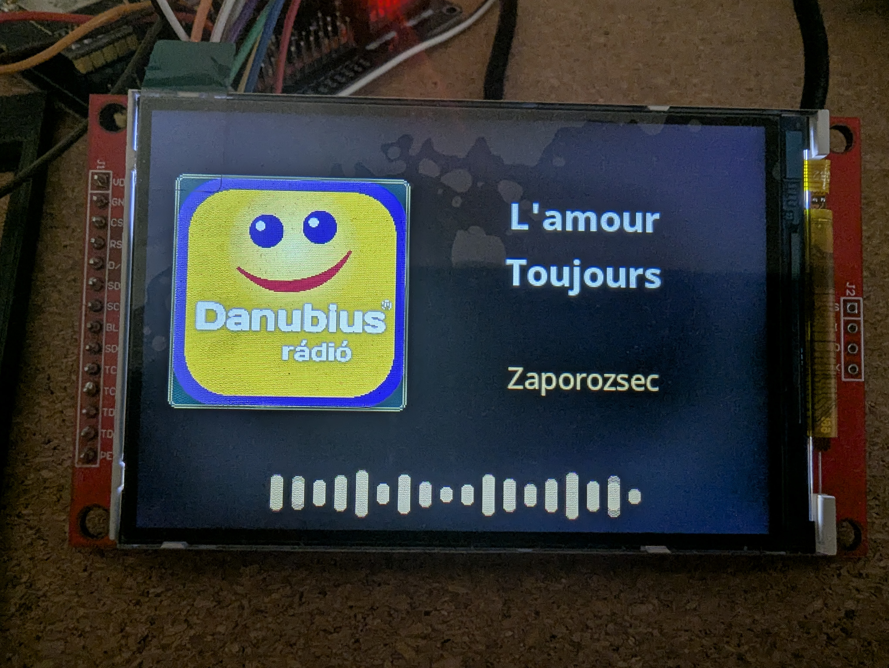
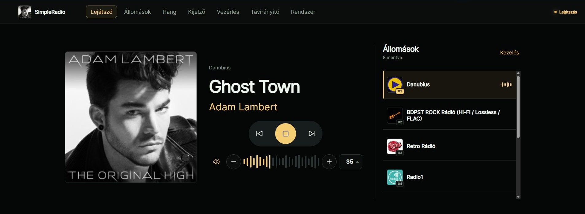
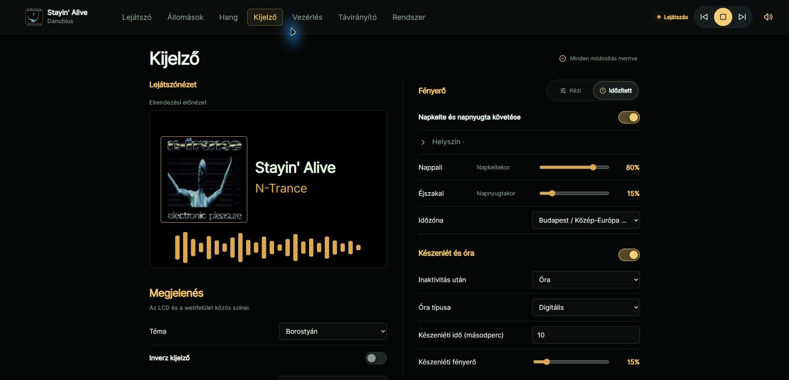
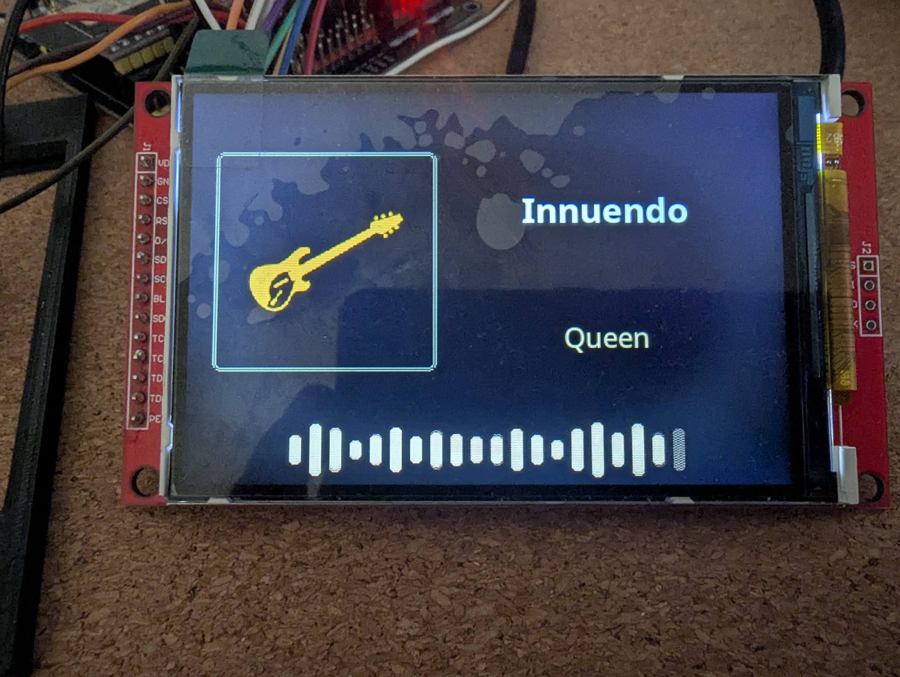
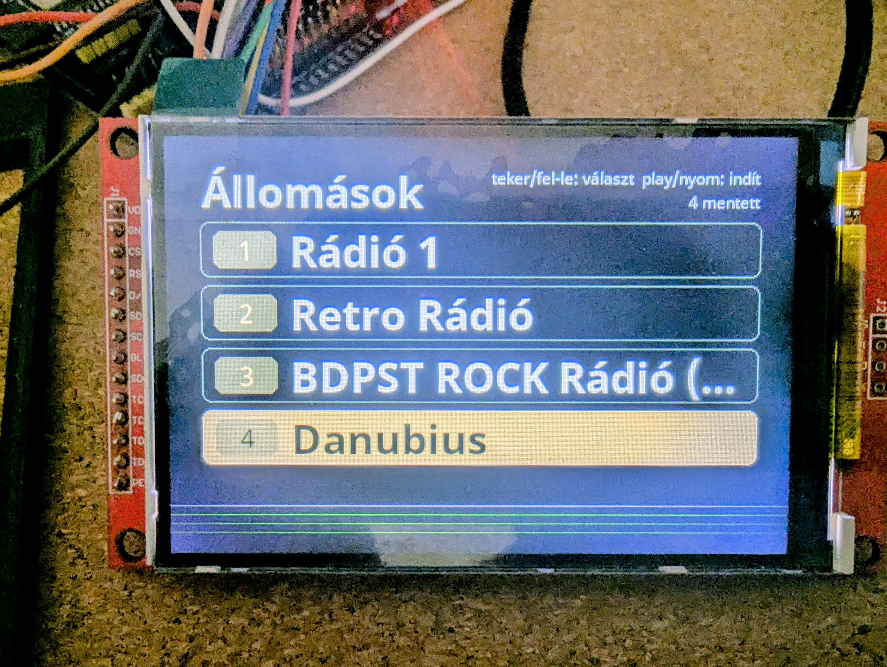
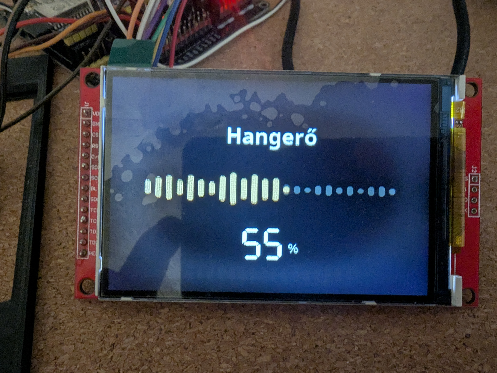
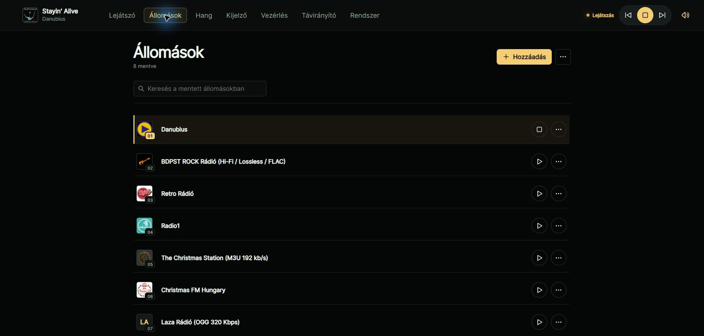

# SimpleRadio

[English](README.md)

A SimpleRadio egy otthon is megépíthető, ESP32-S3 alapú internetrádió. A lejátszást a készüléken vagy a helyi hálózaton, böngészőből is vezérelheted.

## Főbb funkciók

- **LCD-lejátszó** állomáslogóval, albumborítóval és műsorinformációval. A kijelzőn VU-mérő, spektrum vagy óra is megjeleníthető.
- **Webes lejátszó és állomáskezelő** mobilra és asztali gépre, állomáskereséssel, yoRadio-kompatibilis CSV-importtal és -exporttal, valamint hang- és kijelzőbeállításokkal.
- **Vezérlés és integráció** forgóenkóderrel, opcionális infrás távirányítóval és RGB-világítással, valamint automatikus MQTT-felismeréssel a Home Assistantban.

## Hardver és telepítés

A referencia-összeállítás egy **ESP32-S3 N16R8** modulra, egy **ILI9488 480×320-as SPI LCD-re** és egy **I²S DAC-ra vagy erősítőre** épül (például MAX98357A). ST7796 (480×320) és ILI9341 (320×240) kijelzőhöz is van profil.

1. A [hardware_config.h](src/config/hardware_config.h) fájlban állítsd be a bekötésednek megfelelő lábkiosztást és kijelzőprofilt. A [secrets.example.ini](secrets.example.ini) mintát másold át egy helyi `secrets.ini` fájlba.
2. PlatformIO-ban töltsd fel a firmware-t a `pio run -t upload`, a webfelületet pedig a `pio run -t uploadfs` paranccsal. Első telepítéskor mindkettő szükséges.
3. Ha még nincs beállítva a Wi-Fi, csatlakozz a rádió **ESP32-WebRadio** hálózatához. A későbbi frissítéseket a webfelület **Rendszer → Frissítés** oldalán indíthatod.

A webfelületen indított LittleFS-frissítés megőrzi a beállításokat, az állomáslistát és a mentett állomáslogókat.

A Wi-Fi beállításakor adhatsz a rádiónak hálózati nevet. Például a `konyha-radio` névvel a `http://konyha-radio.local/` címen érhető el mDNS-t támogató helyi hálózaton. Üres mezőnél a készülék egyedi nevet kap. A nevet később a **Rendszer → Áttekintés → Hálózati név** alatt módosíthatod. Az IP-cím továbbra is használható.

## Útmutatók

- [Nyelvek és fordítási sablonok](docs/languages.md) · A magyar és az angol nyelv fordításkor választható. Az LCD-hez és a webfelülethez saját fordítást is készíthetsz.
- [Home Assistant beállítása](docs/home-assistant.md) · [Előlapi RGB-világítás](docs/front-led.hu.md)

## Képernyőképek

A webes képek működés közben készültek a rádióról. A galériában a fizikai LCD-ről készült fotók is láthatók.

További LCD-fotók és webes képernyőképek

| LCD-lejátszó képpel | LCD-állomásválasztó |
| --- | --- |
|  |  |
| Hangerő | Állomáskezelő |
|  |  |

## Licenc és támogatás

[GNU GPL v3](LICENSE) · [Külső függőségek és licencek](THIRD_PARTY_NOTICES.md)

Ha hasznosnak találtad a SimpleRadio projektet, meghívhatsz egy kávéra!  
Köszönöm!
