# SimpleRadio

[English documentation](README.md)

**SimpleRadio** egy ESP32-S3 alapú internet-rádió firmware modern webes felülettel és külön LCD-lejátszóképernyővel. Saját építésű, I2S hangkimenetes, fizikai vezérlős és opcionális otthonautomatizálási integrációjú rádióhoz készült.

> Jelenlegi verzió: **0.8.21** · ESP32-S3 N16R8 · LittleFS · magyar és angol felület

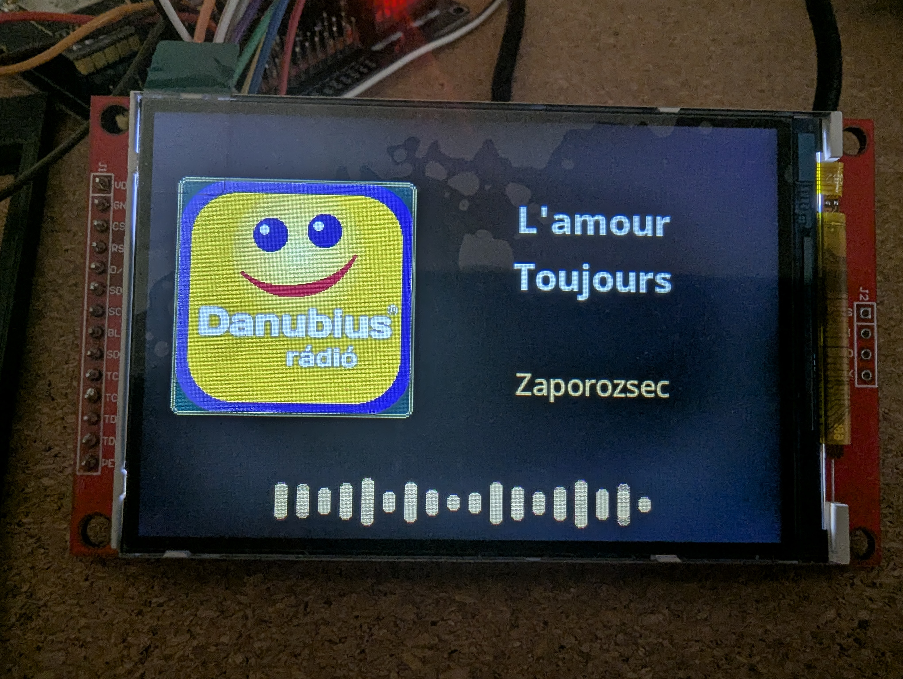

## Főbb képességek

- LCD-lejátszó állomáslogóval, metaadatokkal, hangerőnézettel, állomásválasztóval, VU/alsó sáv módokkal és készenléti órákkal.
- Webes kezelőfelület lejátszáshoz, állomáskereséshez és -szerkesztéshez, EQ/balance-hoz, kijelzőhöz, enkóderekhez, IR-távirányítóhoz, WiFihez, MQTT-hez és OTA-hoz.
- MP3, AAC/AAC+, FLAC, OGG/Vorbis, Opus és más, az `ESP32-audioI2S` által támogatott streamformátumok.
- Helyi fájlból, állomás-URL-ből, ICY metaadatból vagy Radio Browserből érkező logók; az LCD-re optimalizált cache gyorsítja az ismételt lejátszást.
- Egy vagy két forgóenkóder, opcionális IR-vevő és előlapi RGB LED. A webes felület automatikusan letiltja a hardverprofilban nem engedélyezett vezérlőket.
- MQTT discovery és opcionális [Home Assistant Lovelace kártya](home-assistant/README.md).

## Támogatás

Ha hasznosnak találtad a SimpleRadio projektet, meghívhatsz egy kávéra! 

<a href="https://ko-fi.com/zsoltsogorka" target="_blank" rel="noopener noreferrer"></a>

Köszönöm!

## Hardverprofil

A tesztelt célhardver **ESP32-S3 N16R8**, **ILI9488 480x320 SPI kijelzővel** és I2S hangkimenettel (például két MAX98357A modullal sztereóhoz). ST7796 480x320 és ILI9341 320x240 profil is elérhető.

Az első build előtt a nyelvet, kijelzőt, pineket és opcionális hardvert a [`src/config/hardware_config.h`](src/config/hardware_config.h) fájlban állítsd be. A jelenlegi profil egy forgóenkódert és IR-vevőt használ.

## Saját nyelv hozzáadása

A felület nyelve fordításkor a `hardware_config.h` fájl `UI_LANGUAGE` értékével választható; a beépített értékek: `hu`, `en` és az angol `eng` aliasa. Saját nyelvhez másold a [firmware-sablont](src/i18n/lang_template.h) `lang_xx.h`, a [webes sablont](data/i18n/template.js) pedig `xx.js` néven, fordítsd le mindkettőt a kulcsok és helyőrzők megtartásával, állítsd be a `#define UI_LANGUAGE xx` értéket, majd fordítsd újra a firmware-t és a LittleFS/data image-et. A teljes útmutató: [nyelvi leírás](data/i18n/README.md).

## Telepítés és frissítés

Nyisd meg a projektet VS Code-ban PioArduino vagy PlatformIO támogatással, állítsd be a `hardware_config.h` fájlt, majd töltsd fel a firmware-t és a data image-et is:

```powershell
pio run
pio run -t upload
pio run -t uploadfs
pio device monitor -b 115200
```

Első telepítésnél mindkét feltöltés szükséges. A `data/` mappa módosítása után töltsd fel újra a data image-et; csak C++ módosítás után elég a firmware feltöltése. Ha nincs elmentett WiFi, a rádió az `ESP32-WebRadio` hozzáférési pontot indítja a beállításhoz.

Az első vezetékes feltöltés után a Rendszer oldalon firmware- és data-OTA frissítés is elérhető. A data OTA lecseréli a LittleFS-t; a WiFi, konfiguráció, állapot és állomáslista mentésre kerül, a logócache újragenerálódik.

A firmware és a WebUI/data külön verzióval, valamint közös Web API-kompatibilitási szinttel rendelkezik. Az eltérő kiadási verziók használhatók együtt, ha az API-szint kompatibilis. Inkompatibilis vagy hiányzó WebUI-manifest esetén a firmware a normál felület helyett egy LittleFS-től független helyreállítási OTA-oldalt indít, ahonnan a megfelelő firmware vagy data image feltölthető. A `data/build-info.json` fájlt a build automatikusan generálja a `src/config/version.h` értékeiből.

Lejátszás közben a firmware korlátlanul újrapróbálja a megszakadt streamet, ha a stream-retry be van kapcsolva; a késleltetés fokozatosan nő, legfeljebb 60 másodpercig. WiFi-szakadáskor ötmásodpercenként explicit újracsatlakozási kísérlet történik, a hálózat visszatérése után pedig a stream újraindítása automatikusan folytatódik. Az LCD külön jelzi a WiFi-hiányt, a kapcsolódást és a stream újrapróbálkozását.

A `secrets.ini` opcionális és Git által figyelmen kívül hagyott fájl. A [`secrets.example.ini`](secrets.example.ini) alapján csak helyi buildidejű beállításokhoz hozd létre, például fix teszt-Wifihez, MQTT-hitelesítéshez vagy saját OTA-jelszóhoz.

## Képernyőképek

### LCD működés közben

| Lejátszó | Lejátszó logóval |
| --- | --- |
|  | 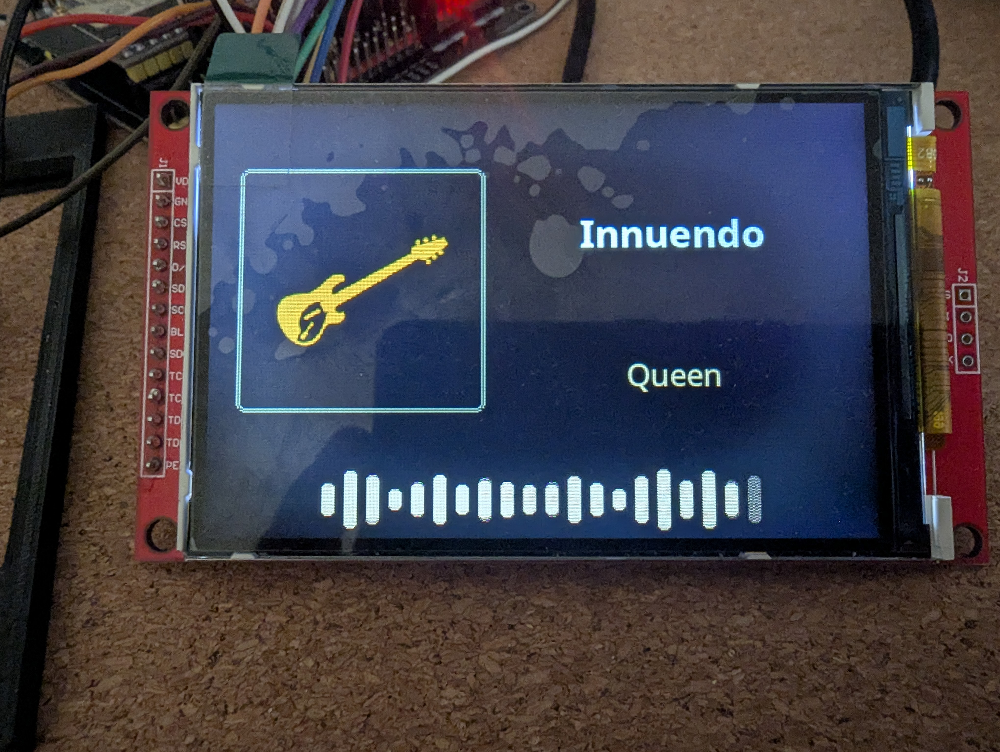 |
| Állomásválasztó | Hangerő |
| 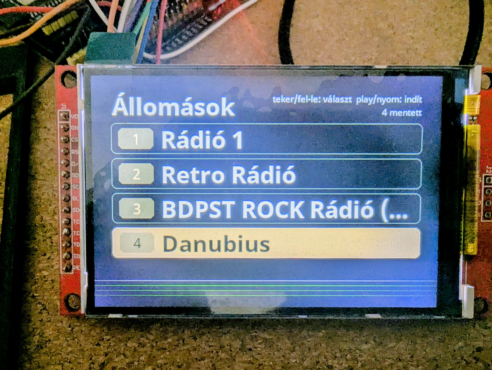 | 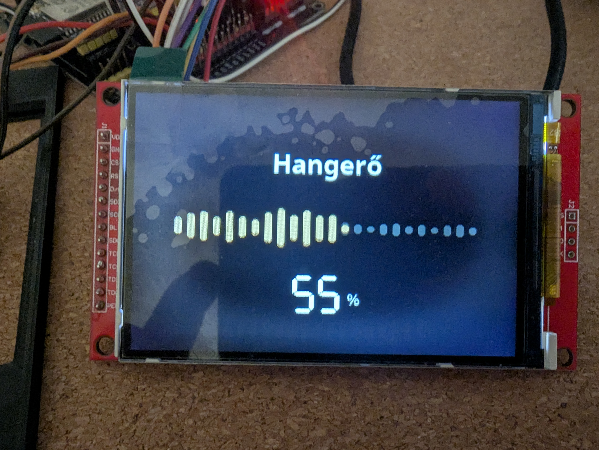 |

### Webes felület

| Lejátszó | Állomások |
| --- | --- |
| 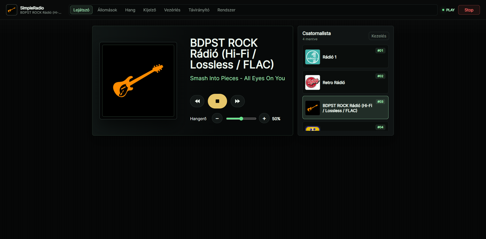 | 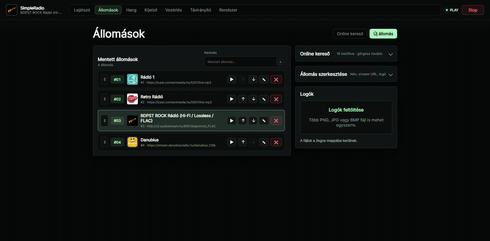 |
| Hang | Kijelző |
| 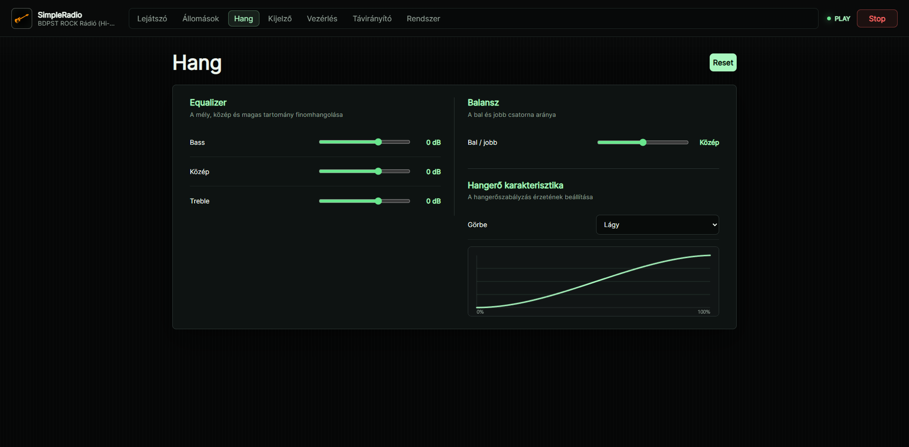 | 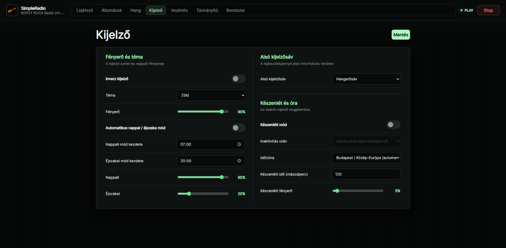 |
| Vezérlés | Távirányító |
| 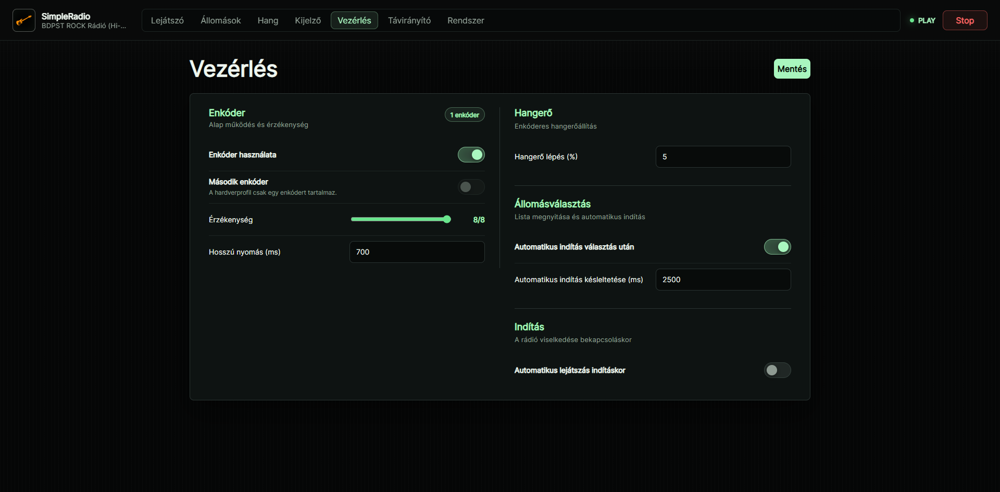 | 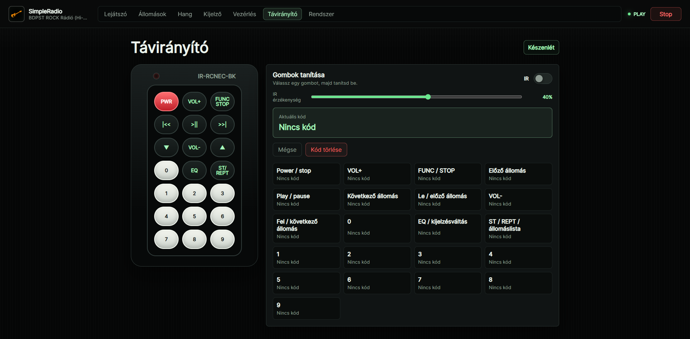 |
| Rendszer | |
| 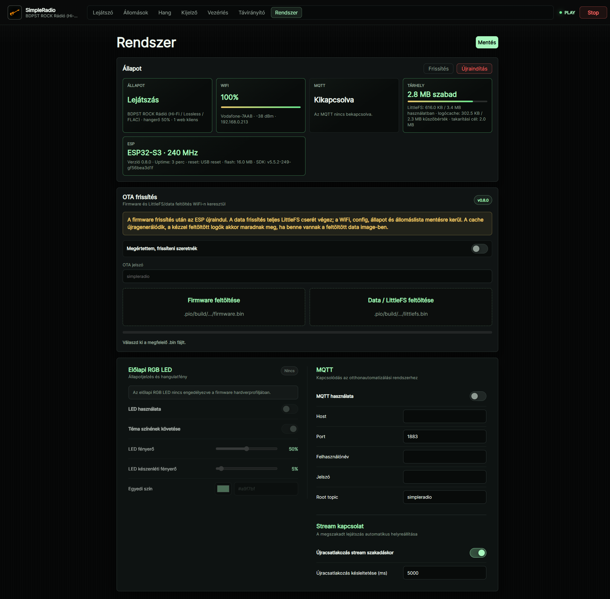 | |

## Projekt felépítése

```text
data/             Webes felület, nyelvek, alapállomások és WiFi oldal
home-assistant/   Lovelace kártya és Home Assistant beállítás
src/              Firmware: audio, kijelző, bemenetek, MQTT, állomások és webserver
tools/            Build segédprogramok
```

## Licenc

A SimpleRadio [GNU GPL v3](LICENSE) licenc alatt jelenik meg. A közvetlen függőségek a saját licencük alatt maradnak; lásd a [harmadik féltől származó megjegyzéseket](THIRD_PARTY_NOTICES.md).
