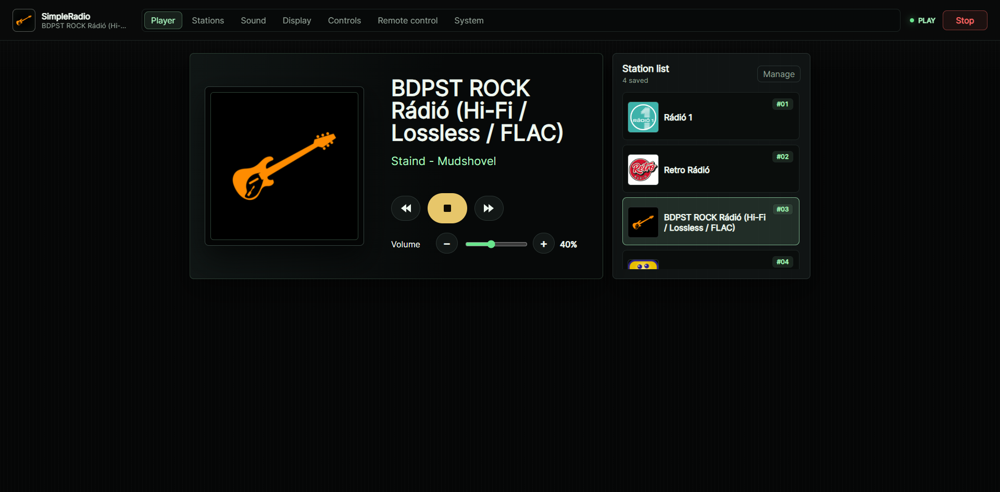
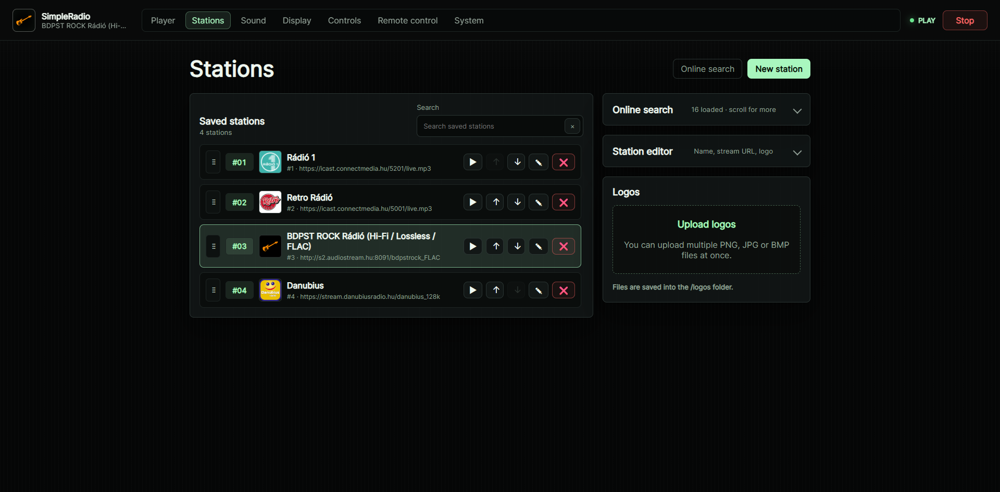
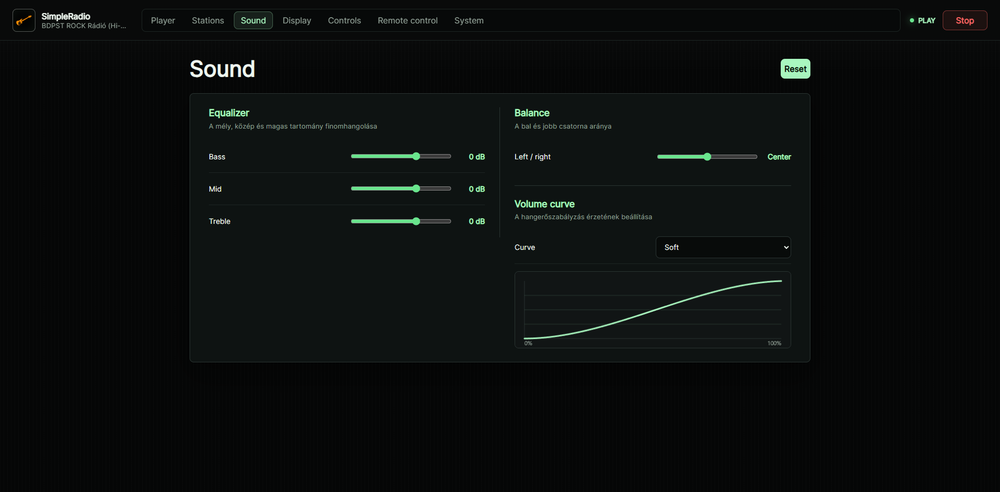
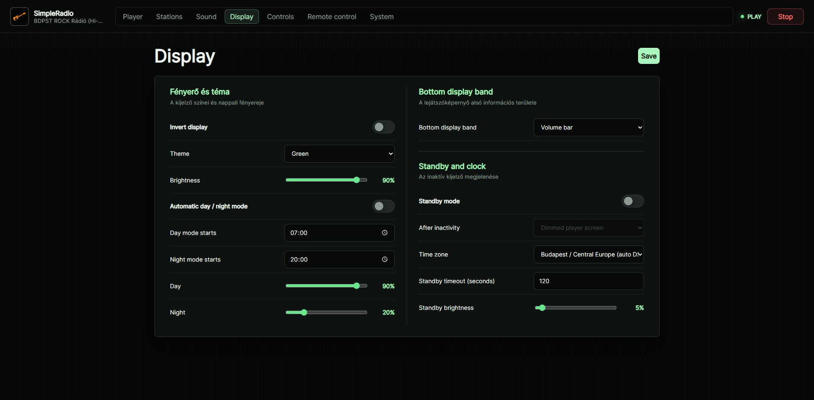
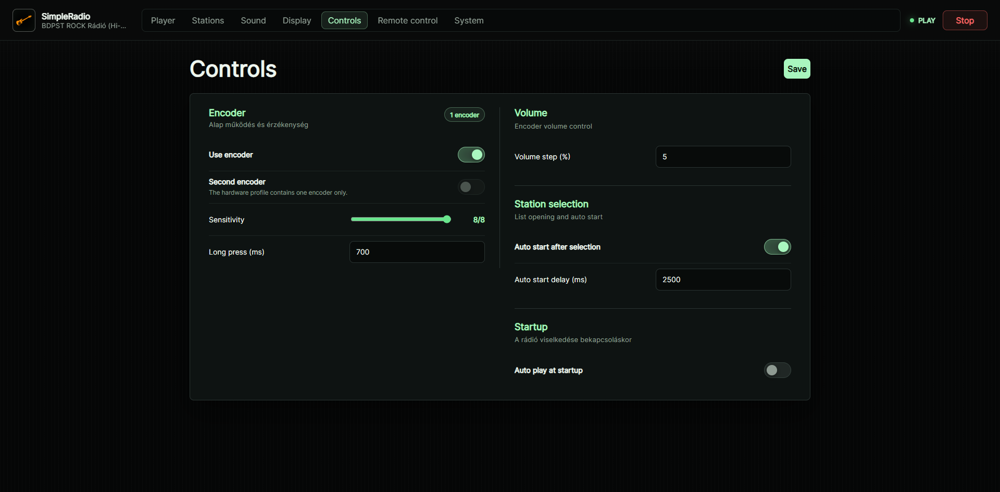
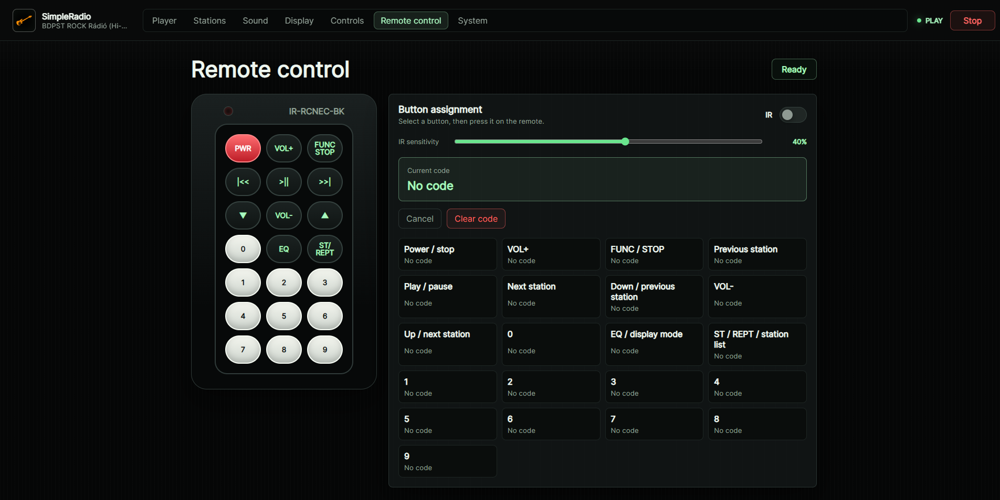
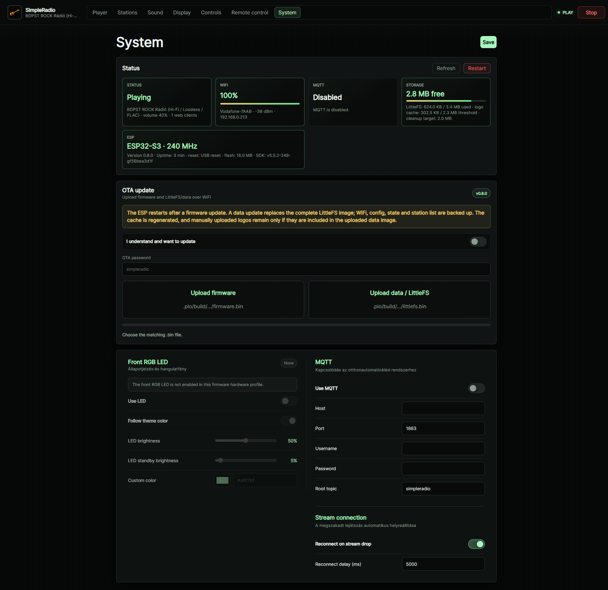

# SimpleRadio

[Magyar dokumentáció](README.hu.md)

**SimpleRadio** is an ESP32-S3 internet-radio firmware with a modern web interface and a dedicated LCD player view. It targets a self-built radio with I2S audio, physical controls and optional smart-home integration.

> Current version: **0.8.24** · ESP32-S3 N16R8 · LittleFS · English and Hungarian UI


## Highlights

- LCD player with station artwork, metadata, volume screen, station picker, VU/footer modes and idle clocks.
- Optional 24-band, 512-point FFT spectrum footer with third-octave logarithmic spacing (and a lowest-bass bucket), time-based smoothing and the symmetric VU's full-width bar grid. Select **Spectrum (24 bands, FFT)** under **Display → Bottom display band**. A worker below audio priority analyzes post-EQ stereo Q31 PCM, preserving quiet-volume precision and compensating the common playback volume law; EQ and balance remain reflected in the spectrum. Integrated, Hann-window-corrected RMS band energy drives a musical square-root-amplitude curve instead of a flat 60dB-to-height mapping. One bounded level follower (-12..+6 dB, very slow boost) preserves band ratios; 50% visual sensitivity halves heights before final clipping. There is no per-band equalization or artificial animation. Startup tests include Q31, windowed RMS, quiet volume and DC/silence. Five-second `[spectrum]` diagnostics include all 24 band dB values, callback-copy time, near-full-scale sample counts and RMS levels. The capture budget stays 20 Hz, with no FFT or allocation in the audio callback. Stop disables analysis immediately but lets the LCD envelope decay to zero in about 0.6 seconds; hiding clears it immediately. Existing VU modes remain available.
- Web UI for playback, station editing and search, EQ/balance, display settings, encoders, IR remote, WiFi, MQTT and OTA.
- MP3, AAC/AAC+, FLAC, OGG/Vorbis, Opus and other stream formats supported by `ESP32-audioI2S`.
- Artwork from local files, station URLs, ICY metadata or Radio Browser; LCD-ready cache keeps repeated playback responsive.
- Searched JPEG/PNG album covers use a bounded two-slot PSRAM store for both the web image and the center-cropped LCD pixels, without per-track flash writes. Web transfers retain their exact image until complete; unavailable memory falls back to the station logo. Covers are temporary and do not survive a reboot. Audio-library version and task priorities are unchanged; `[album-art] timing RAM-*` lines report preparation time.
- One or two rotary encoders, optional IR receiver and optional front-panel RGB LED. The UI automatically disables controls for hardware not enabled in the firmware profile.
- MQTT discovery and an optional [Home Assistant Lovelace card](home-assistant/README.md).

## Support

If you found SimpleRadio useful, you can buy me a coffee!

<a href="https://ko-fi.com/zsoltsogorka" target="_blank" rel="noopener noreferrer"></a>

Thank you!

## Hardware profile

The tested target is an **ESP32-S3 N16R8** with an **ILI9488 480x320 SPI display** and I2S output (for example, two MAX98357A modules for stereo). ST7796 480x320 and ILI9341 320x240 profiles are also available.

Before the first build, configure the language, display, pins and optional hardware in [`src/config/hardware_config.h`](src/config/hardware_config.h). The shipped profile uses one rotary encoder and an IR receiver.

## Add a language

The interface language is selected at build time with `UI_LANGUAGE` in `hardware_config.h`; built-in values are `hu`, `en` and the `eng` alias. To add your own language, copy the [firmware template](src/i18n/lang_template.h) to `lang_xx.h` and the [web template](data/i18n/template.js) to `xx.js`, translate both while preserving keys and placeholders, set `#define UI_LANGUAGE xx`, then rebuild firmware and LittleFS/data. See the complete [language guide](data/i18n/README.md).

## Install and update

Open the project in VS Code with PioArduino or PlatformIO, configure `hardware_config.h`, then upload both firmware and the data image:

```powershell
pio run
pio run -t upload
pio run -t uploadfs
pio device monitor -b 115200
```

The first installation requires both uploads. Re-upload the data image after changing files under `data/`; C++ changes only require a firmware upload. If no WiFi is stored, the radio starts the `ESP32-WebRadio` access point for provisioning.

After the first wired upload, firmware and data updates are available from the System page. A data OTA replaces LittleFS; WiFi, configuration, state and stations are backed up, while the artwork cache is regenerated.

Firmware and WebUI/data have separate release versions plus a shared Web API compatibility level. Different release versions may run together when their API levels are compatible. If the WebUI manifest is missing or incompatible, the firmware serves a LittleFS-independent recovery OTA page instead of the normal interface, allowing the matching firmware or data image to be installed. `data/build-info.json` is generated automatically during builds from `src/config/version.h`.

While playback is requested, an interrupted stream is retried indefinitely when stream retry is enabled; the delay increases up to 60 seconds. After WiFi loss, the firmware explicitly attempts reconnection every five seconds and resumes stream recovery when the saved network returns. The LCD distinguishes WiFi loss, station connection and stream retry states.

`secrets.ini` is optional and intentionally ignored by Git. Create it from [`secrets.example.ini`](secrets.example.ini) only for local build-time overrides such as fixed test WiFi, MQTT credentials or a custom OTA password.

To preconfigure Last.fm, add `-D SIMPLE_RADIO_LASTFM_API_KEY=\"YourLastFmApiKey\"` to the existing `build_src_flags` list in your local `[env:esp32-s3-devkitc1-n16r8]` section. The System page recognizes this key without exposing it. A key saved in the web interface takes priority; clearing that saved key restores the compiled default. Removing the compiled key requires rebuilding and uploading firmware without that flag. Never commit real keys; compiled firmware also contains the key. No data upload is needed for this setting.

The pinned audio library remains unchanged in version. During builds, `tools/patch_audio_hls.py` applies a narrowly scoped HLS playlist URL-resolution fix (including `../` parent paths) to the local dependency. It adds no network requests and refuses an unfamiliar library source rather than silently applying an incompatible patch.

## Screenshots

### LCD in use

| Player | Player with artwork |
| --- | --- |
|  |  |
| Station picker | Volume |
|  |  |

### Web interface

| Player | Stations |
| --- | --- |
|  |  |
| Sound | Display |
|  |  |
| Controls | Remote control |
|  |  |
| System | |
|  | |

## Project structure

```text
data/             Web UI, languages, default stations and provisioning page
home-assistant/   Lovelace card and Home Assistant setup
src/              Firmware: audio, display, inputs, MQTT, stations and web server
tools/            Build helpers
```

## License

SimpleRadio is licensed under the [GNU GPL v3](LICENSE). Direct dependencies keep their own licenses; see [third-party notices](THIRD_PARTY_NOTICES.md).
