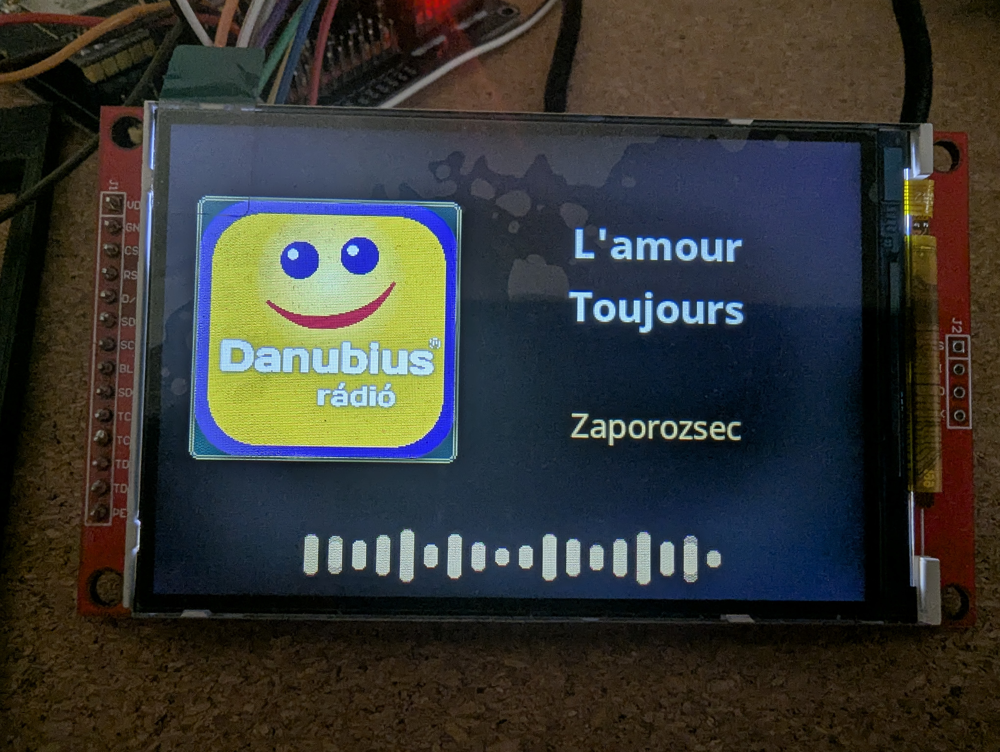
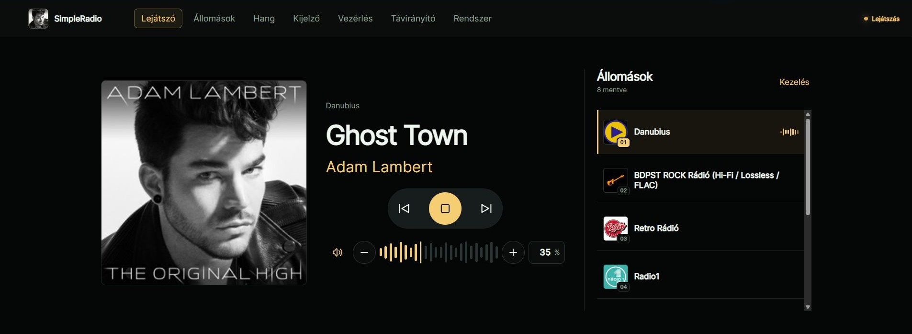
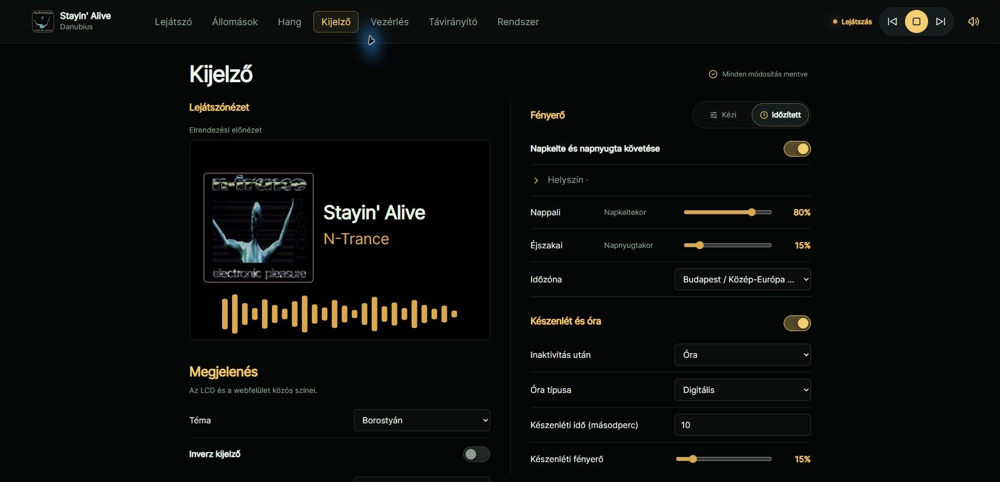
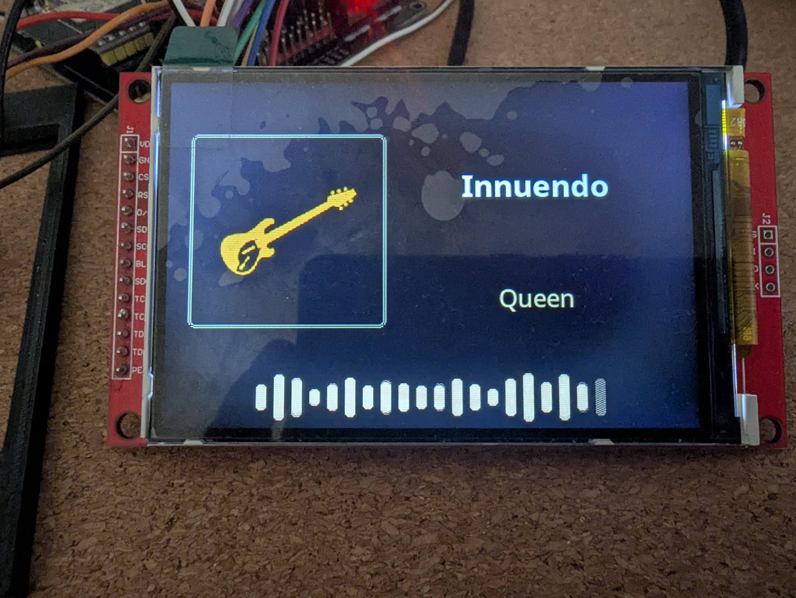
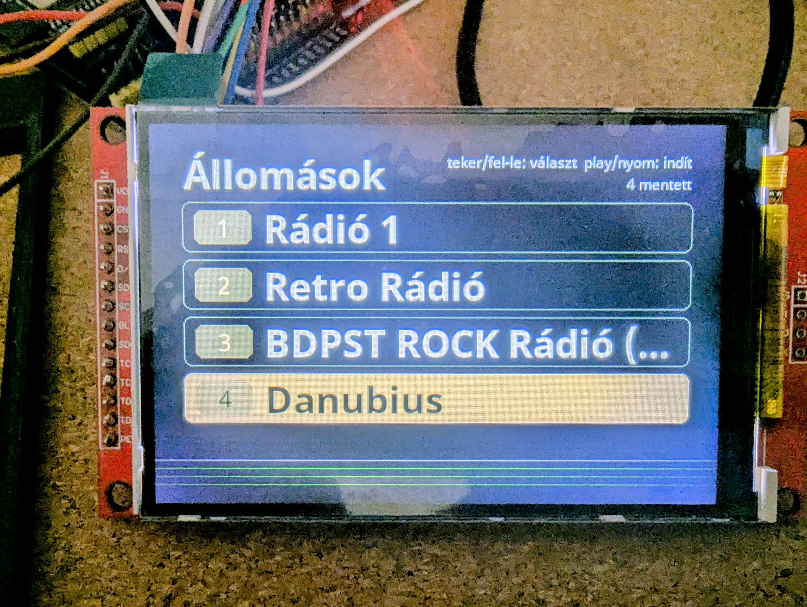
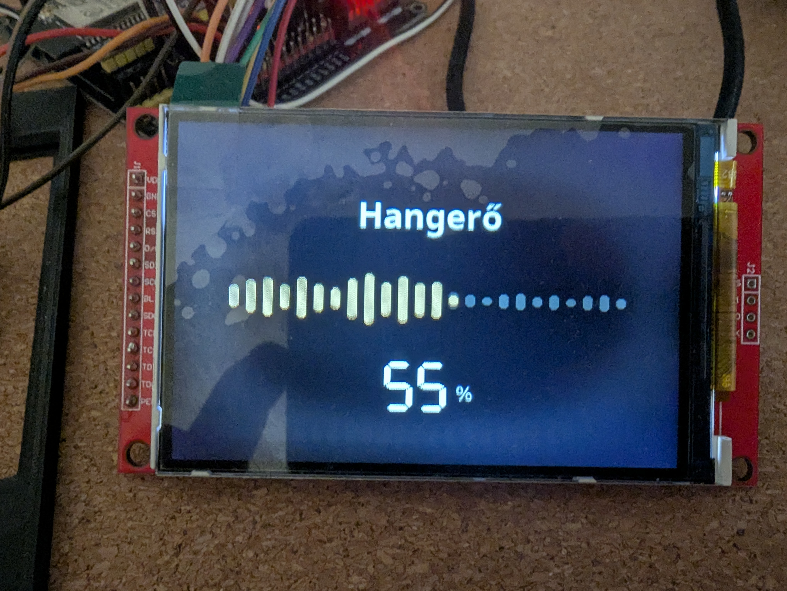
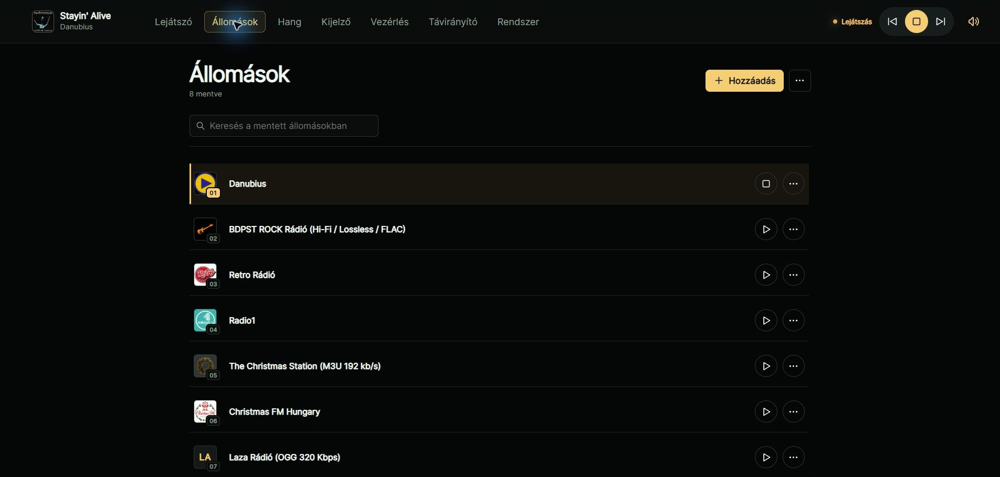

# SimpleRadio

[Magyar](README.hu.md)

SimpleRadio is an ESP32-S3 internet radio you can build yourself. Listen to your favorite stations and control playback from the radio or a browser on your local network.

## Features

- **LCD player** with station logos, album artwork and track information. Choose a VU meter, spectrum or clock view.
- **Web player and station manager** for phones and desktops, with station search, yoRadio-compatible CSV import/export, and audio and display settings.
- **Physical controls and integration** with rotary encoders, an optional IR remote and RGB lighting, plus MQTT discovery for Home Assistant.

## Hardware and setup

The reference build uses an **ESP32-S3 N16R8**, an **ILI9488 480×320 SPI LCD** and an **I²S DAC or amplifier** such as the MAX98357A. Display profiles are also available for the ST7796 (480×320) and ILI9341 (320×240).

1. Match the pins and display profile to your wiring in [hardware_config.h](src/config/hardware_config.h). Copy [secrets.example.ini](secrets.example.ini) to a local `secrets.ini`.
2. In PlatformIO, upload the firmware with `pio run -t upload` and the web interface with `pio run -t uploadfs`. The first install needs both.
3. If Wi-Fi is not configured, join the radio’s **ESP32-WebRadio** setup network. For later updates, use **System → Update** in the web interface.

LittleFS updates through the web interface preserve settings, stations and saved station logos.

During Wi-Fi setup you can give the radio a network name. For example, `kitchen-radio` opens at `http://kitchen-radio.local/` on a local network with mDNS support. Leave the field blank for a unique device name. You can change it later under **System → Overview → Network name**. The IP address still works.

## Guides

- [Languages and translation templates](docs/languages.md) · Choose English or Hungarian at build time, or create a translation for the LCD and the web interface.
- [Home Assistant setup](docs/home-assistant.md) · [Front-panel RGB lighting (Hungarian)](docs/front-led.hu.md)

## Screenshots

Web screenshots from a running SimpleRadio with its Hungarian interface. The gallery also includes photos of the physical LCD.

More LCD photos and web screenshots

| LCD player with artwork | LCD station picker |
| --- | --- |
|  |  |
| Volume | Station manager |
|  |  |

## License and support

[GNU GPL v3](LICENSE) · [Third-party notices](THIRD_PARTY_NOTICES.md)

If you found SimpleRadio useful, you can buy me a coffee!  
Thank you!
