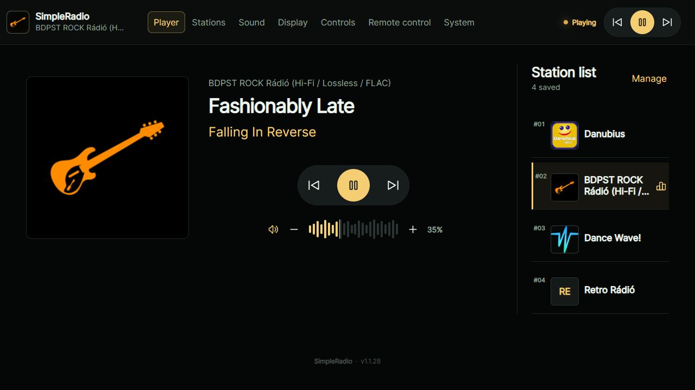
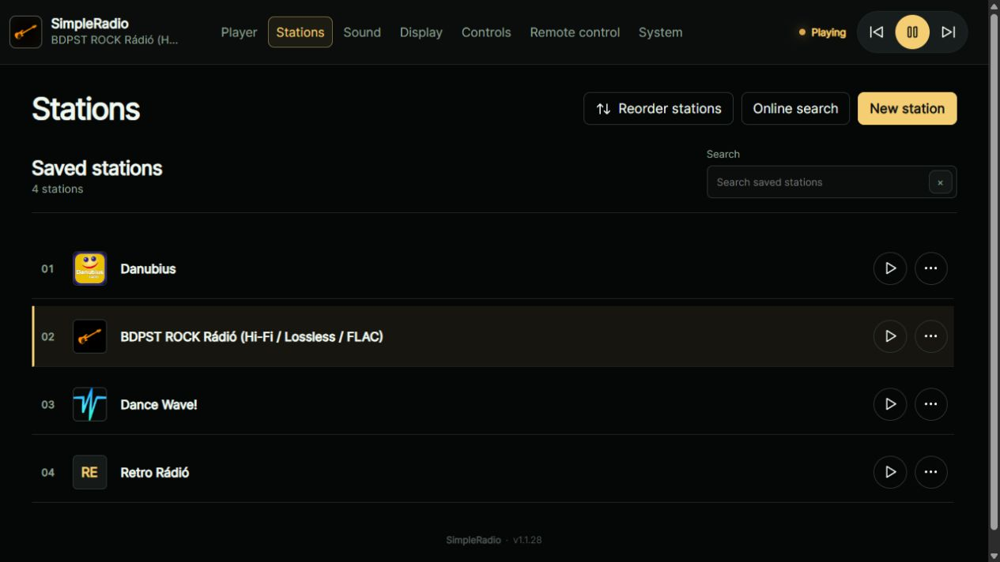
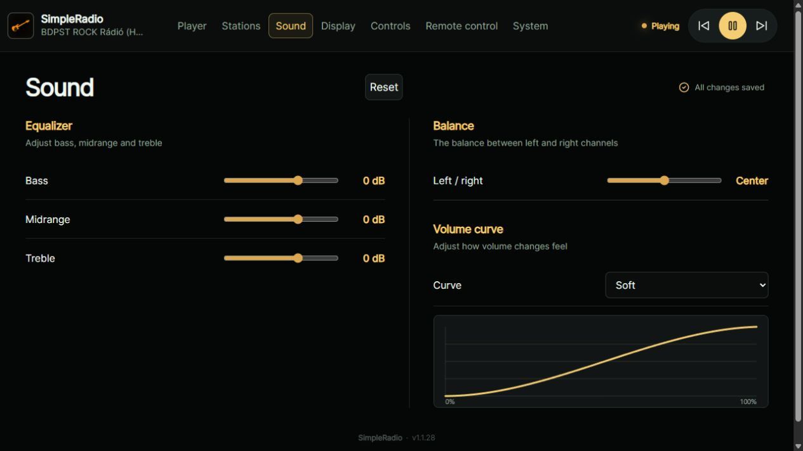
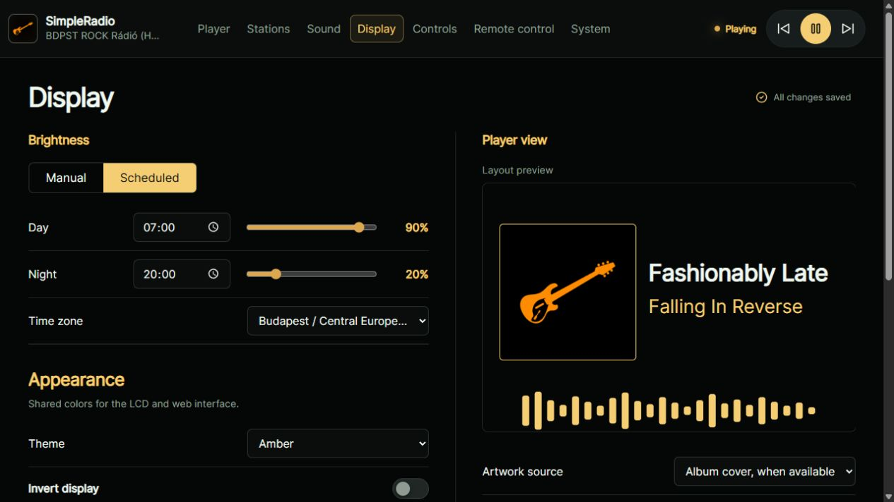
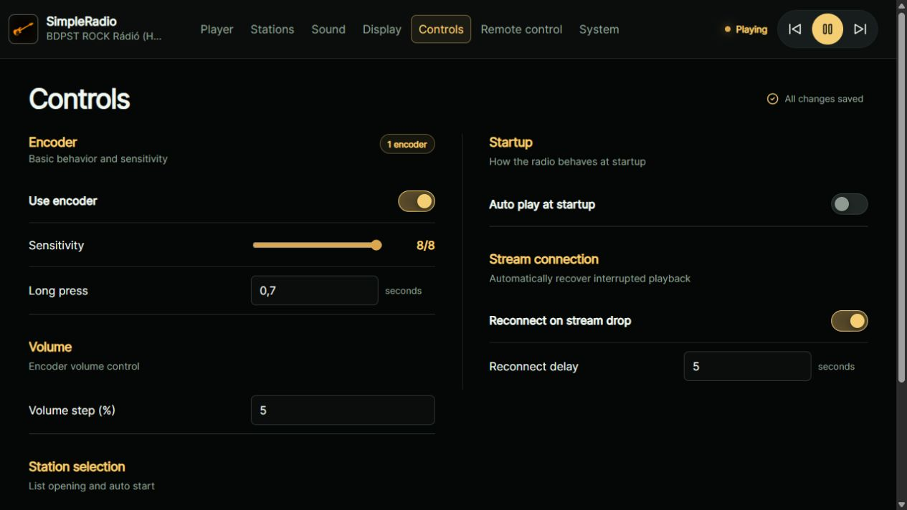
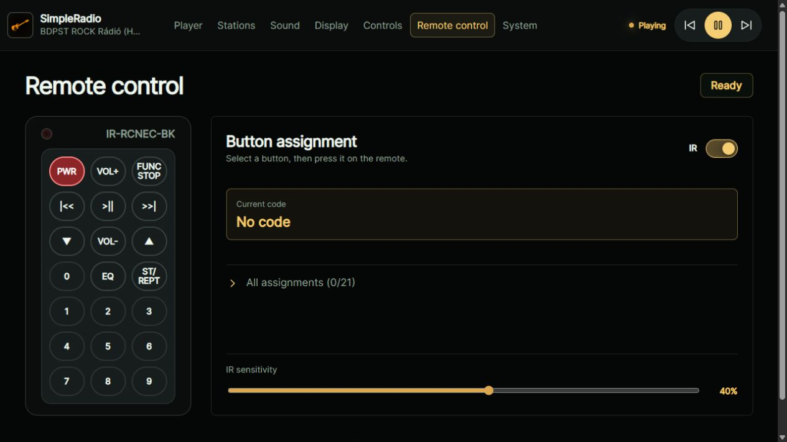
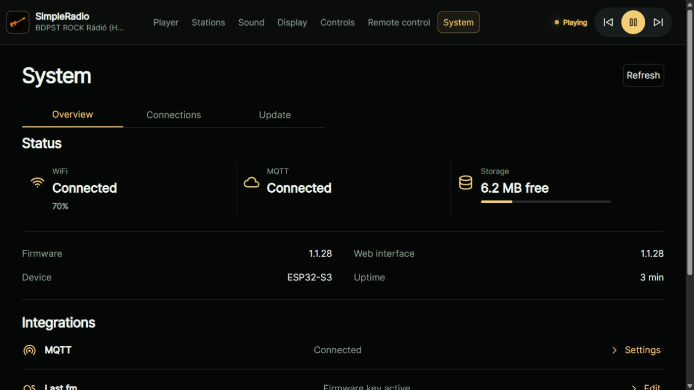
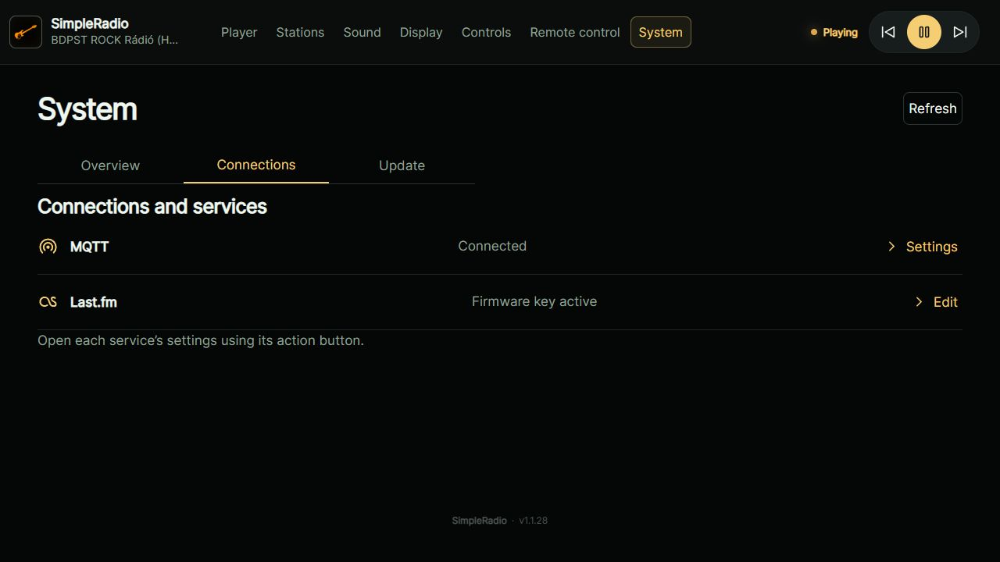
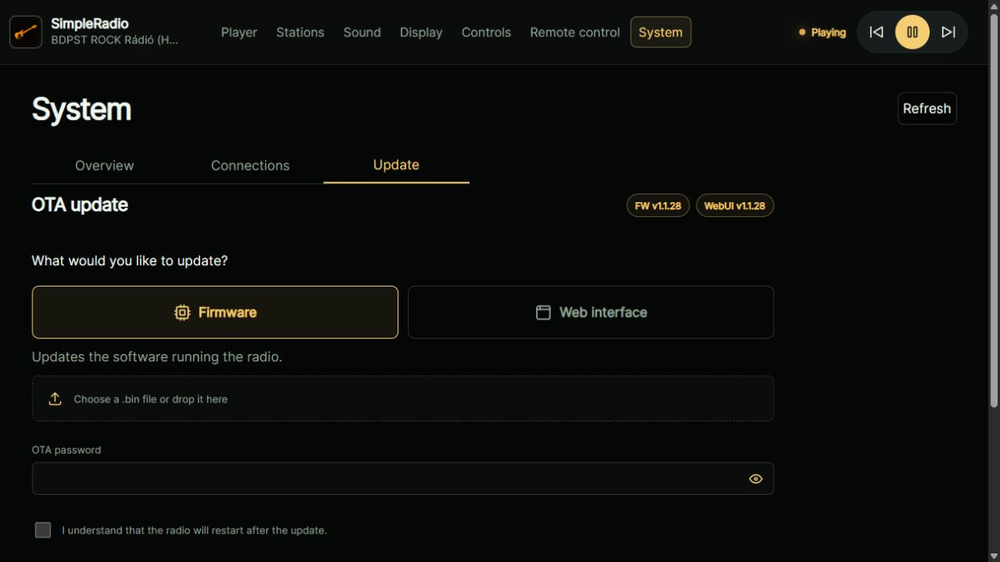

# SimpleRadio

[Magyar](README.hu.md)

> Current version: **1.1.28** · ESP32-S3 N16R8 · English and Hungarian UI

## Features

- Internet radio with I2S audio; MP3, AAC/AAC+, FLAC, OGG/Vorbis and Opus support.
- LCD player with station logos or album covers, artist and track title.
- Fast station picker with small logos; VU meters, 24-band FFT spectrum and idle clocks.
- Mobile-friendly web UI: playback, station search, EQ, balance and display settings.
- Shared LCD/web themes; live slider previews, saved when adjustment ends.
- One or two rotary encoders, optional IR remote and RGB LED.
- MQTT discovery and a [Home Assistant card](home-assistant/README.md).

## Hardware and configuration

- Tested hardware: **ESP32-S3 N16R8**, **ILI9488 480×320 SPI LCD**, I2S DAC/amplifier such as MAX98357A.
- Additional display profiles: ST7796 480×320 and ILI9341 320×240.
- Pins, hardware and build-time language: [`hardware_config.h`](src/config/hardware_config.h).
- Custom languages: [guide and templates](data/i18n/README.md).
- WiFi, Last.fm, MQTT and OTA defaults: local `secrets.ini`, based on the [example](secrets.example.ini). Keep real keys and passwords private.
- The Last.fm API key can also be set on the web **System** page; a web-saved key takes priority.

## Installation and updates

- Development environment: VS Code + PlatformIO/PioArduino; the project manages dependencies.
- First installation: firmware — `pio run -t upload`; WebUI/data — `pio run -t uploadfs`. **Both are required.**
- Without saved WiFi, connect to the **ESP32-WebRadio** access point to configure the network.
- Subsequent OTA uploads: the web **System → Update** page.
- Firmware changes need a firmware upload; `data/` changes need a data upload; upload both when both change.
- Data OTA preserves settings and stations; the logo cache is rebuilt.
- Serial log: `pio device monitor -b 115200`.
- Central firmware/WebUI versions: [`version.h`](src/config/version.h); web version metadata is generated during builds.

## Links

- [Web UI and LCD behaviour](docs/ui-refresh.md)
- [GNU GPL v3 license](LICENSE) · [Third-party dependencies and licenses](THIRD_PARTY_NOTICES.md)

## Screenshots

- Web screenshots: the current UI's local preview with sample data; LCD images are actual photographs.

| LCD player | LCD player with artwork |
| --- | --- |
|  |  |
| Station picker | Volume |
|  |  |
| Web player | Stations |
|  |  |
| Sound | Display |
|  |  |
| Controls | Remote control |
|  |  |
| System – Overview | System – Connections |
|  |  |
| System – Update | |
|  | |
